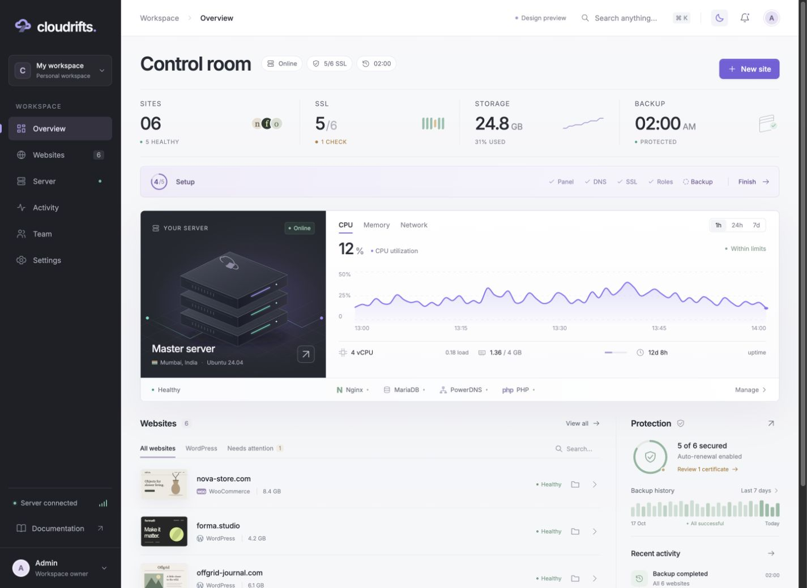

# Cloudrifts Hosting Panel

Cloudrifts is a modern, source-available hosting control panel for a fresh Ubuntu 24.04 VPS. It is built for people who want a clean way to manage WordPress, WooCommerce, and PHP websites with real server actions instead of a heavy traditional control panel.



[Website](https://retrixdev.github.io/cloudrifts/) | [Installation guide](docs/INSTALL.md) | [Feature status](docs/FEATURES.md) | [Security notes](docs/SECURITY.md)

## Install

Recommended for a fresh Ubuntu 24.04 x86_64 VPS:

```bash
curl -fsSL __GIST_RAW_INSTALL_URL__ | sudo bash
```

Repository mirror:

```bash
curl -fsSL https://raw.githubusercontent.com/RetrixDev/cloudrifts/main/install.sh | sudo bash
```

The bootstrap installer downloads the pinned GitHub release bundle, verifies its SHA256 checksum, extracts it, and runs the real Cloudrifts bundle installer.

## What Cloudrifts Manages

- WordPress, WooCommerce, and plain PHP website provisioning.
- Linux website users, document roots, PHP-FPM pools, and MariaDB databases.
- Nginx and Apache installs, with switch workflows for Nginx, Apache, OpenLiteSpeed, and LiteSpeed when the target server is available.
- Let's Encrypt SSL attempts with DNS preflight, exact failure reasons, retry jobs, and required DNS records.
- Website file browsing, file editing, access logs, error logs, and PHP logs.
- Full local backups and privileged restore jobs.
- Optional managed DNS through PowerDNS.
- Optional mail role setup/status through Postfix and Dovecot.
- A React/Vite PWA with overview, websites, server roles, activity, team, and settings views.

## Why It Exists

Most VPS owners search for a hosting control panel, VPS control panel, WordPress control panel, cPanel alternative, CyberPanel alternative, or CloudPanel alternative because they want a focused tool that gets a website online without forcing a large platform around it. Cloudrifts is designed for that lane: single-server hosting with visible job steps, clear recovery hints, and a premium browser interface.

## Current Status

Cloudrifts is an early Phase 1 release. The current installer and bundle target fresh Ubuntu 24.04 x86_64 servers. Use it on a test VPS first, read the setup URL carefully, and avoid exposing an unfinished panel to untrusted networks until you have reviewed the security notes.

## Quick Setup Flow

1. Start with a clean Ubuntu 24.04 VPS.
2. Run the install command above.
3. Open the one-time setup URL printed by the installer.
4. Enter your own panel domain, such as `panel.example.com`.
5. Choose external DNS or enable managed DNS.
6. Create WordPress, WooCommerce, or PHP websites from the dashboard.
7. Use job trails, diagnostics, SSL retry, logs, files, and backups from the panel.

## System Paths

| Purpose | Path |
| --- | --- |
| Binaries | `/usr/local/bin/cloudriftsd`, `/usr/local/bin/cloudrifts-agent`, `/usr/local/bin/cloudriftsctl` |
| Data | `/var/lib/cloudrifts` |
| Config | `/etc/cloudrifts` |
| Logs | `/var/log/cloudrifts` |
| Web UI | `/usr/local/share/cloudrifts/web` |
| Service | `cloudriftsd.service` |

## Local Development

```bash
git clone https://github.com/RetrixDev/cloudrifts.git
cd cloudrifts
cd apps/web
npm install
cd ../..
./scripts/dev.sh
```

Local frontend: `http://localhost:5173`

Local API: `http://localhost:8080`

## Release

Current test release:

- Version: `0.1.0-dev`
- Target: Ubuntu 24.04, Linux x86_64
- Asset: `cloudrifts-panel-0.1.0-dev-linux-amd64.tar.gz`
- SHA256: `ed22857fc20ec0377269238e95b2fe12abf4ee7d3ea63c409cd8097fecf0d64d`

Build from source:

```bash
./scripts/build-release.sh
```

## Security

Cloudrifts performs privileged host operations through a narrow `cloudrifts-agent` sudo policy. It is still an early development release, so review [SECURITY.md](docs/SECURITY.md) before using it on a public server.
